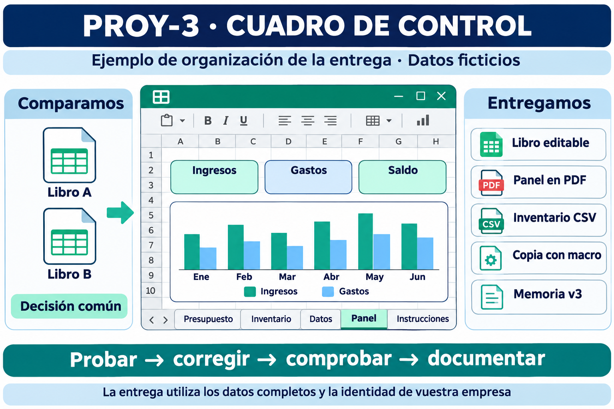

# PROY-3 · Construimos el cuadro de control

**Entrega en Aules: una por pareja · RA3 · Producto: libro de gestión, panel y memoria de empresa v3.**

## 1. Mensaje de gerencia

«Ya tenemos los documentos de nuestra empresa. Ahora necesitamos cambiar un presupuesto sin rehacer las cuentas, saber qué productos reponer y consultar seis meses de ingresos y gastos en una página. Otra persona debe poder abrir el libro, introducir datos y comprobar los resultados siguiendo vuestras instrucciones».

Vais a integrar las soluciones individuales de ACT-3.1–ACT-3.4 en un único libro de empresa. Conservad la identidad y las decisiones de PROY-2. Cada integrante mantiene sus entregas individuales; el proyecto recoge la solución acordada y las pruebas del archivo común.

### Ejemplo visual del proyecto



Fijaos en el recorrido: comparar, decidir, integrar y comprobar. El gráfico es esquemático y no representa los resultados de los datos comunes. Vuestra entrega debe utilizar los seis meses completos y la identidad de vuestra empresa; la memoria v3 se entrega en editable y PDF. Consultad el apartado 8 para los nombres y formatos exactos y la condición de la copia con macro.

## 2. Punto de partida y tiempo

Tened abiertos:

- La última carpeta de empresa y `EMPRESA_EquipoXX` de PROY-2.
- Los libros y las pruebas de ambos integrantes de ACT-3.1–ACT-3.4.
- Los [datos comunes](ud03-datos.md) y la [rúbrica con batería de pruebas](ud03-evaluacion.md).

La integración se realiza dentro del cierre de ACT-3.4: sus 6 horas incluyen auditoría, automatización, control individual de 40 minutos, integración y defensa. PROY-3 no añade horas a las 34 de UD03. Aprovechad las comparaciones realizadas durante las actividades para llegar al cierre con una base elegida. La fecha objetivo común para A/B la indicará el profesor; no hay una fecha fijada en este documento.

## 3. Comparad antes de integrar

1. Conservad los originales individuales y una copia de la versión 2 de empresa.
2. Abrid ambos libros y comprobad una fórmula, un aviso y la actualización del panel.
3. Elegid un libro como base. Incorporad las mejoras útiles del otro y volved a probarlas: copiar hojas puede modificar referencias, rangos y validaciones.
4. Alternad los roles de producción y calidad. Cada integrante debe revisar algo que haya integrado su compañero.
5. Registrad los acuerdos en la memoria, con referencias a hojas o celdas del libro final.

Usad una tabla como esta, completada con vuestro trabajo real:

| Parte | Solución de A | Solución de B | Decisión común y motivo | Comprobación en el libro final |
| --- | --- | --- | --- | --- |
| Presupuesto | [Referencia del impuesto y diseño] | [Referencia y diseño] | [Qué conservamos y por qué] | [Celda y prueba] |
| Inventario | [Avisos y validación] | [Avisos y validación] | [Elección justificada] | [Código y prueba] |
| Panel | [Resumen y gráfico] | [Resumen y gráfico] | [Elección justificada] | [Rango y actualización] |
| Revisión | [Fallo o limitación detectados] | [Fallo o limitación detectados] | [Corrección o pendiente] | [Resultado observado] |

## 4. Qué debe contener el libro común

| Hoja | Contenido mínimo | Qué debe poder comprobar quien lo use |
| --- | --- | --- |
| Presupuesto | Cuatro servicios de los datos comunes; cantidad, precio e importe; subtotal, impuesto configurable y total; precio medio, máximo y mínimo | Cambiar cantidad, precio o impuesto actualiza los resultados; el impuesto no se suma dos veces |
| Inventario | Seis productos P01–P06; datos de origen, stock, valor, aviso, validación, filtro y búsqueda exacta por código | El aviso incluye el caso stock igual al mínimo; se conserva la relación entre código y producto al ordenar |
| Datos | Doce registros de los seis meses, con Mes, Tipo, Concepto e Importe | Los importes son numéricos y Tipo utiliza Ingreso o Gasto |
| Panel | Ingresos, gastos y saldo del periodo; resumen mensual mediante tabla dinámica, gráfico de ingresos/gastos y dos conclusiones con cifras | Los totales se pueden rastrear hasta Datos; al cambiar un importe y actualizar la tabla dinámica cambia el gráfico |
| Instrucciones | Aplicación y versión usadas, entradas editables, actualización, avisos, impresión, pruebas y limitaciones | Otra persona puede usar el libro y repetir una prueba sin que se lo expliquéis de palabra |

Podéis añadir `Listas` para las validaciones. El impuesto puede mantenerse en la celda usada en ACT-3.1: identificadla en Instrucciones y utilizad referencias absolutas. Una hoja de configuración separada es opcional; evitad mantener dos valores distintos para el mismo impuesto.

Separad visualmente las entradas de las fórmulas e indicadlo también mediante una leyenda escrita. Proteged al menos una hoja dejando editables sus entradas. Conservad la fecha de revisión, la etiqueta código-producto y la imagen propia o con procedencia documentada de ACT-3.4. Las zonas de práctica de referencias mixtas pueden quedar identificadas fuera del área de impresión.

### Del presupuesto de UD02 al libro

Reutilizad nombre de empresa, colores, estructura documental y criterio de presentación de PROY-2. Para las comprobaciones comunes, mantened los cuatro servicios, cantidades y precios de UD03. Si el presupuesto de UD02 utilizaba otros conceptos, explicad la adaptación en la memoria. El documento anterior se conserva como antecedente; las cuentas de esta versión deben proceder de fórmulas.

El 21 % de los datos comunes es un supuesto didáctico configurable. Los ingresos y gastos mensuales son datos ficticios independientes del presupuesto y se trabajan sin impuestos. No suméis el total del presupuesto a los ingresos mensuales ni presentéis el saldo simplificado como una contabilidad completa.

### Referencias visuales

Revisad los ejemplos de [presupuesto](ud03-actividad-1.md), [inventario](ud03-actividad-2.md), [panel](ud03-actividad-3.md) y [auditoría](ud03-actividad-4.md). Sirven para interpretar la organización del producto. La entrega utiliza los datos completos y la identidad de vuestra empresa.

## 5. Comprobad el archivo que vais a entregar

Repetid en el libro común las nueve pruebas de la [batería de UD03](ud03-evaluacion.md). Las pruebas individuales sirven como antecedente, pero no demuestran que la integración funcione.

1. Cambiar una cantidad y comprobar línea, subtotal, impuesto y total.
2. Cambiar el impuesto configurable y revisar las referencias.
3. Probar stock inferior, igual y superior al mínimo.
4. Intentar una cantidad negativa en una entrada validada.
5. Buscar un código existente y otro inexistente.
6. Cambiar un ingreso, actualizar la tabla dinámica y comprobar resumen y gráfico.
7. Editar una entrada y comprobar que una fórmula protegida no se puede sobrescribir.
8. Ejecutar y explicar la macro breve de formato en una copia compatible.
9. Reabrir el editable y revisar el PDF exportado.

Registrad las pruebas en Instrucciones; podéis usar varias filas para los tres casos de stock:

| Prueba y celda/rango | Valor inicial y cambio | Resultado esperado | Resultado observado | Corrección y repetición | Restauración y responsable |
| --- | --- | --- | --- | --- | --- |
| [Qué se comprueba] | [Una modificación cada vez] | [Antes de ejecutar] | [Lo que realmente ocurre] | [Acción y resultado, o no procede] | [Valor restaurado y quién verifica] |

No copiéis resultados del ejemplo ni marquéis una prueba como superada si no la habéis realizado. Registrad al menos la corrección comprobada de ACT-3.4; si el libro no presenta fallos conocidos, utilizad la copia con el fallo introducido por el docente e identificadla como prueba de reparación. Restaurad los datos iniciales antes de exportar.

### Copia con macro

Reutilizad la macro mínima de formato de ACT-3.4 y probad su alcance en `PruebaMacro`. No necesitáis programar ni automatizar el libro completo. En Calc guardad la copia en ODS; en Excel de escritorio, en XLSM. Anotad aplicación, nombre de macro, pasos de ejecución y si actúa sobre la selección o posiciones fijas.

Seguid el [taller guiado de ACT-3.4](ud03-actividad-4.md), que explica cómo grabar, guardar dentro del documento, ejecutar y comprobar tras reabrir. Cread la copia con macro a partir del libro común final y repetid allí la grabación breve: copiar una hoja individual no garantiza transferir su macro. Las evidencias individuales se conservan; esta prueba confirma el funcionamiento del archivo de pareja.

Si el aula no dispone de grabadora, registrad la limitación y la demostración acordada con el profesor. La ejecución individual queda pendiente cuando no se ha observado. La copia sin macros debe permitir comprobar todas las operaciones principales.

## 6. Ampliad la memoria de empresa a v3

Trabajad sobre una copia de `EMPRESA_EquipoXX` v2. Incorporad el bloque **Cuadro de control · UD03** antes de las conclusiones. Conservad la historia anterior y actualizad portada, índice, ficha de empresa y registros existentes.

```text
Cuadro de control · UD03
  Necesidad y continuidad con el sistema documental
  Comparación de las dos soluciones y decisiones comunes
  Presupuesto, inventario y panel: uso y referencias al libro
  Pruebas, correcciones y limitaciones
  Datos preparados para UD04
Conclusiones y pendientes actualizados
Registros de decisiones, versiones y contribuciones actualizados
```

Redactad una síntesis con referencias precisas. El libro contiene las fórmulas y el registro detallado de pruebas; la memoria explica qué adoptáis, por qué y con qué evidencia. No hace falta pegar las cuatro actividades completas ni duplicar tablas de pruebas.

Ejemplo de redacción para completar con resultados propios:

> Comparamos [alternativa de A] y [alternativa de B]. Adoptamos [decisión] porque [motivo]. En el libro común lo comprobamos modificando [entrada de hoja y celda]. Esperábamos [resultado] y observamos [resultado real]. La evidencia está en [prueba]. Queda pendiente [limitación, si existe].

En el catálogo de productos de la memoria indicad nombre, ruta relativa, función y autoría de cada archivo entregado. Las contribuciones deben describir acciones comprobables: integrar una validación, revisar una fórmula o repetir una prueba concreta. Registrad las fechas reales.

## 7. Preparad el intercambio con UD04

Exportad la tabla final de Inventario como `PROY-3_EquipoXX_Inventario.csv`, con encabezados y seis productos. Incluid sus columnas de datos y los valores calculados de Stock, Valor y Aviso. Excluid totales, imágenes y la zona de búsqueda. El CSV guarda valores; las fórmulas se conservan en el libro.

Volved a abrir el CSV y comprobad códigos P01–P06, acentos, columnas, decimales y número de registros. Anotad en Instrucciones la codificación y el separador usados. Conservad códigos estables y una fila por producto. Si necesitáis exportar una hoja temporal, eliminad de ella las zonas ajenas a la tabla antes de guardar; mantened intacto el libro principal.

En UD04 utilizaréis esta tabla y el catálogo de servicios de la empresa como punto de partida para el modelo de datos. Clientes, relaciones e incidencias se desarrollarán allí. En este hito no se exige crear esas tablas ni un inventario por movimientos.

## 8. Entrega de la pareja

Organizad una carpeta `PROY-3_EquipoXX` con estos archivos y entregadla comprimida en ZIP en Aules:

| Archivo | Contenido |
| --- | --- |
| `PROY-3_EquipoXX_Control.ods` o `.xlsx` | Libro principal funcional sin necesidad de ejecutar macros; Instrucciones incluye pruebas |
| `PROY-3_EquipoXX_Panel.pdf` | Panel de los seis meses en una página legible, con título, periodo, unidades, gráfico y conclusiones |
| `PROY-3_EquipoXX_Inventario.csv` | Tabla de intercambio reabierta y comprobada |
| `PROY-3_EquipoXX_Macro.ods` o `.xlsm` | Copia compatible con la macro y su prueba; si no se pudo realizar, limitación registrada según lo acordado con el profesor |
| `EMPRESA_EquipoXX.odt` o `.docx`, y `EMPRESA_EquipoXX.pdf` | Dos formatos de la misma memoria actualizada a v3, con catálogo y registros |

Las referencias al libro y al CSV deben funcionar dentro de la carpeta entregada. No incluyáis entregas de otros equipos ni datos personales ajenos al trabajo. Indicad fuentes y uso de IA cuando corresponda. Conservad aparte las versiones anteriores y los originales individuales.

## 9. Evaluación y defensa individual

Se utiliza la distribución común de los hitos de empresa:

| Apartado | Puntos | Evidencia en PROY-3 |
| --- | ---: | --- |
| Producto técnico y pruebas | 4 | Libro funcional, CSV, PDF y pruebas de integración |
| Continuidad con la empresa | 2 | Identidad y presupuesto de UD02, memoria acumulativa y datos preparados para UD04 |
| Comparación e integración | 1,5 | Alternativas de ambos y decisiones justificadas con comprobaciones |
| Documentación, orden y accesibilidad | 1 | Instrucciones utilizables, catálogo, archivos accesibles y panel legible |
| Versiones y contribuciones | 0,5 | Historial real y revisión cruzada de ambos integrantes |
| Defensa individual | 1 | Explicación y modificación comprobadas por cada integrante |

El bloque técnico de 4 puntos se obtiene aplicando la [rúbrica técnica de UD03](ud03-evaluacion.md), sobre 10, y multiplicando su resultado por 0,4. Así se conserva su reparto 30/25/20/15/10 sin sumar dos veces la misma nota técnica. En los otros apartados se valora la integración de empresa; un mismo fallo no se penaliza de nuevo por arrastre.

RA3 es la referencia de aprendizaje. Las evidencias abarcan fórmulas y referencias, funciones, gráficos, análisis, intercambio y automatización según la auditoría curricular de trabajo (CA a–h). Su correspondencia literal con la programación oficial sigue pendiente de contraste; este enunciado no incorpora textos normativos nuevos.

Estas ponderaciones internas mantienen el reparto general del módulo: encargos y proyectos 50 %, prácticas individuales 20 %, controles prácticos 20 % y portafolio/defensa/seguimiento 10 %. La defensa aquí descrita verifica el hito; no se registra automáticamente como una segunda nota en otra categoría.

Cada integrante, durante el trabajo autónomo de la clase, deberá:

1. Explicar una fórmula elegida por el profesor y el origen de sus datos.
2. Cambiar una entrada distinta de la de su compañero, anticipar el resultado y comprobarlo.
3. Mostrar una decisión común y su aportación verificable; restaurar los datos al terminar.

Ambos deben comprender el libro completo. La valoración individual se apoya en la defensa y en las contribuciones observables.

## 10. Lista final, apoyos y mejora

- [ ] Seguimos con la misma empresa y conservamos la versión 2.
- [ ] El libro incluye las cinco hojas y los datos completos de la unidad.
- [ ] Las fórmulas y avisos funcionan tras la integración y la tabla dinámica se actualiza.
- [ ] Las nueve pruebas tienen resultado observado o limitación explícita.
- [ ] El CSV se ha reabierto y el PDF del panel se lee en una página.
- [ ] La memoria v3 explica acuerdos y enlaza los productos; el índice está actualizado.
- [ ] Los archivos entregados se abren desde la carpeta final.
- [ ] Ambos podemos explicar y modificar el libro.

**Apoyo:** partid del libro más estable, revisad primero dos filas y usad los asistentes ya trabajados. Si una parte falla, reparad y repetid su prueba antes de cambiar el diseño. **Ampliación opcional:** mejorad la navegación o las instrucciones sin añadir hojas de gestión complejas. Para recuperar, corregid los apartados pendientes, repetid sus pruebas y demostrad individualmente el aprendizaje afectado.
