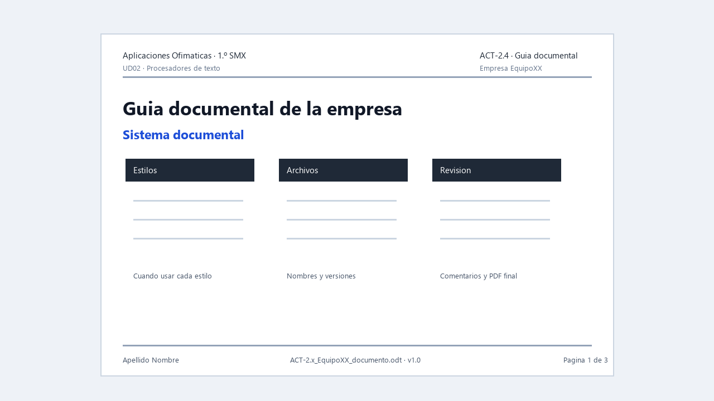

# ACT-2.4 · La web documental de la empresa



*Ejemplo visual orientativo: no hay que copiarlo exactamente, pero muestra una guía con normas claras sobre estilos, archivos y revisión.*

**Tarea en Aules:** `ACT-2.4 · La web documental de la empresa`
**Archivo:** `ACT-2.4_EquipoXX_web.pdf` · **Pareja** · 3 h.

## Encargo

La empresa necesita una página sencilla donde organizar su documentación: quiénes somos, qué plantilla usamos, qué formatos se aceptan, cómo se entregan documentos y qué normas deben seguir los integrantes.

No es una web publicitaria. Es una web o página documental para trabajar mejor.

## Qué debe contener

La página debe incluir:

1. Nombre de la empresa y actividad.
2. Cliente objetivo.
3. Servicios principales.
4. Enlace o referencia a la plantilla corporativa.
5. Tabla de formatos internos y formatos de entrega.
6. Normas de estilo documental.
7. Protocolo breve de revisión.
8. Protocolo básico de protección de datos.
9. Enlaces o referencias a documentos creados en UD02.
10. Registro de versión de la web.

## Requisitos técnicos

Puede realizarse en Markdown, Google Sites, una página HTML sencilla o la herramienta indicada por el profesorado.

Debe cumplir:

- Títulos jerárquicos.
- Navegación clara.
- Enlaces comprobados.
- Imágenes o capturas sin datos personales.
- Texto propio y adaptado a la empresa.
- Coherencia con la plantilla de ACT-2.1.

## Trabajo en pareja

1. Repartid secciones.
2. Revisad que todo use el mismo tono.
3. Comprobad enlaces y permisos.
4. Registrad contribuciones en `EMPRESA_EquipoXX`.
5. Exportad o capturad evidencia para Aules.

## Entrega

Un PDF de pareja con:

- Enlace a la web o captura completa si no se puede publicar.
- Tabla de contenidos de la web.
- Tabla de reparto de tareas.
- Comprobación de enlaces.
- Registro de versión.

## Evaluación

**CA:** RA2.b, RA2.d y RA2.f.

Se valorará que la web organice la documentación real de la empresa, no que tenga efectos visuales. Debe servir para que un compañero entienda cómo crear, revisar y entregar documentos de la empresa.

## Paso a paso para tu primera web documental

Antes de empezar, realiza el ensayo de [Markdown, IA y web desde cero](ud02-teoria-5.md). Para esta ruta guiada usarás Markdown y MkDocs en **Linux/LliureX**. Abre la aplicación **Terminal** y utiliza `python3`; sigue los diez pasos de la teoría para crear el proyecto en `~/web-empresa`. Si el docente indica Google Sites u otra herramienta, conserva las secciones, archivos y pruebas del encargo.

### Fase 1. Preparar los materiales reales

Reúne el nombre y actividad de tu empresa, las decisiones de ACT-2.1 y los documentos terminados. Usa datos ficticios. Copia la plantilla y un PDF aprobado a `docs/archivos` del proyecto de ensayo. No enlaces una carpeta privada de tu ordenador.

Reparte trabajo: una persona prepara Inicio y Documentos; otra prepara Normas. Después intercambiad páginas para revisar. Ambos deben abrir y comprobar los enlaces.

### Fase 2. Completar una estructura casi preparada

Utiliza esta base para `index.md`. Sustituye todos los corchetes que contienen datos pendientes; conserva los corchetes de los enlaces Markdown.

```md
# [NOMBRE DE EMPRESA] · Guía documental

## Para qué sirve esta guía

Somos una empresa ficticia de [ACTIVIDAD]. Ayudamos a [CLIENTE OBJETIVO].
Esta guía explica cómo crear, revisar y entregar nuestros documentos.

## Servicios

- [SERVICIO REAL DEFINIDO EN EL PROYECTO]
- [OTRO SERVICIO]

## Empieza aquí

1. Consulta las [normas de estilo](guia-estilo.md).
2. Abre la página de [documentos y plantillas](documentos.md).
3. Crea el documento y sigue el protocolo de revisión.

## Versión de la guía

| Versión | Fecha | Cambio | Responsable |
| --- | --- | --- | --- |
| 1.0 | [FECHA] | Primera guía documental | [INTEGRANTES] |
```

En `guia-estilo.md` crea los apartados `Estilos`, `Imágenes y tablas`, `Nombres de archivo`, `Revisión` y `Protección de datos`. Cada norma debe indicar una acción concreta y cómo comprobarla.

Ejemplo resuelto: «Aplica Título 1 a los apartados principales. Comprueba que aparecen en el Navegador antes de generar el índice». Una norma como «hacerlo profesional» no indica una acción verificable.

Incluye un ejemplo correcto y uno incorrecto con explicación: «Separar párrafos mediante espacio después» frente a «Pulsar Enter repetidamente». Añade un protocolo numerado: revisar contenido, actualizar campos, revisar capturas, guardar editable, exportar PDF y comprobarlo en un visor.

Para `documentos.md` usa:

```md
# Documentos y plantillas

## Formatos que usamos

| Documento | Formato de trabajo | Formato de entrega |
| --- | --- | --- |
| Informe | ODT | PDF revisado |
| Plantilla | OTT | OTT y documento de prueba |

## Archivos disponibles

- [Descargar plantilla corporativa](archivos/plantilla.ott)
- [Consultar informe de ejemplo](archivos/informe.pdf)
```

La tabla es un ejemplo: adaptadla a las decisiones aprobadas. Los archivos enlazados deben existir con esos nombres o debéis corregir las rutas. Si un manual todavía no está terminado, señaladlo como pendiente, sin crear un enlace roto ni afirmar que ya existe.

### Fase 3. Usar IA con revisión, si lo elegís

Podéis usar el prompt de la teoría para un borrador. Cambiad los datos a vuestra empresa. Guardad el prompt y el fragmento usado, corregid hechos, rutas y estructura y completad el registro de IA. Si no usáis IA, indicadlo. La IA no puede comprobar por vosotros que se descarga vuestra plantilla.

### Fase 4. Construir y probar con otro lector

1. Completa el menú de `mkdocs.yml` con las tres páginas.
2. Abre la vista local con `python3 -m mkdocs serve` desde la carpeta del proyecto.
3. Haz que tu compañero entre por Inicio y encuentre la plantilla, los formatos y el protocolo de revisión.
4. Prueba cada enlace y descarga. Anota el destino y el resultado; corrige fallos y repite.
5. Revisa en una ventana estrecha: títulos, tablas y textos deben seguir siendo legibles.
6. Detén el servidor y construye con `python3 -m mkdocs build --strict`.
7. Conserva las fuentes y `site`. Si no se publica, entrega evidencias completas de las páginas y pruebas. Una dirección `localhost` solo funciona en el equipo que ejecuta el servidor.

### PDF de evidencia: orden listo para seguir

1. Portada: empresa, integrantes, actividad, fecha y versión.
2. Enlace publicado si existe; en caso contrario, indicación de web local y capturas legibles de las tres páginas.
3. Tabla de páginas: nombre y función de cada una.
4. Tabla de reparto: tarea, autor y revisor.
5. Tabla de enlaces: texto, destino, resultado y corrección.
6. Registro de versión y registro de IA o declaración de no uso.

Conservad el proyecto fuente y la web generada para demostrar el trabajo y corregirlo. La entrega en Aules sigue siendo el PDF de evidencia indicado arriba; añadid el proyecto si el docente lo solicita.

**Defensa breve:** cada integrante debe explicar una ruta relativa, mostrar un documento descargable y justificar una norma de revisión. El trabajo está terminado cuando un lector nuevo puede seguir la guía sin ayuda.
