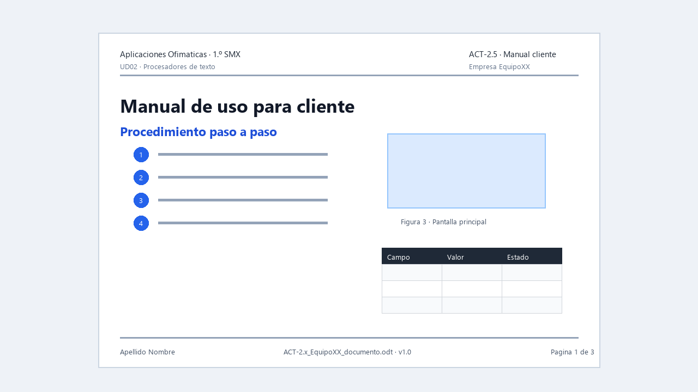

# ACT-2.5 · Manual para un cliente

*Ejemplo visual orientativo: no hay que copiarlo exactamente, pero muestra un manual con índice, pasos, capturas, leyendas y tablas.*

**Tarea en Aules:** `ACT-2.5 · Manual para un cliente`  
**Archivo:** `ACT-2.5_apellido_nombre_manual.zip` · **Individual** · 4 h.

## Encargo

Práctica final de la unidad. A partir de notas en bruto, capturas y requisitos facilitados por el profesorado, debes crear un manual completo para un cliente no técnico.

El manual debe explicar un procedimiento de forma clara, ordenada y verificable. No basta con acumular capturas.

## Vídeo de apoyo

Antes de empezar, revisa en el curso de Writer las lecciones sobre **imágenes**, **pies de foto**, **índices**, **referencias cruzadas** y **exportación a PDF**: [LibreOffice Writer · curso en castellano](https://cursa.app/es/curso-gratis/libreoffice-writter-bfjb).

Mientras lo ves, anota cómo vas a controlar capturas, pasos numerados, referencias y comprobación final del PDF.

## Estructura mínima

El manual debe incluir:

1. Portada.
2. Control de versiones.
3. Índice automático.
4. Introducción para usuario no técnico.
5. Requisitos previos.
6. Procedimiento paso a paso.
7. Capturas con pie.
8. Tabla de problemas frecuentes.
9. Glosario breve.
10. Cierre o comprobación final.

## Condiciones

- Debe crearse desde la plantilla de la empresa.
- Debe usar estilos reales.
- Debe incluir referencias cruzadas.
- Debe tener imágenes controladas.
- Debe exportarse a PDF.
- Debe revisarse como si fuera para un cliente real.

## Lista de comprobación

Antes de entregar:

1. Actualiza índice y campos.
2. Comprueba numeración de páginas.
3. Abre el PDF y revisa todas las páginas.
4. Comprueba que ninguna captura muestra datos personales.
5. Revisa ortografía.
6. Comprueba que el nombre de archivo sigue la norma.
7. Verifica que el editable se abre correctamente.

## Entrega

Un ZIP individual con:

- Manual editable.
- Manual en PDF.
- Lista de comprobación completada.
- Nota breve indicando dos decisiones de diseño y dos correcciones realizadas tras revisar.

## Evaluación

**CA:** RA2.b, RA2.c, RA2.d y RA2.f.

Se valorará que el manual sea útil para una persona real: orden, claridad, capturas necesarias, estructura automática, PDF correcto y ausencia de datos sensibles.
