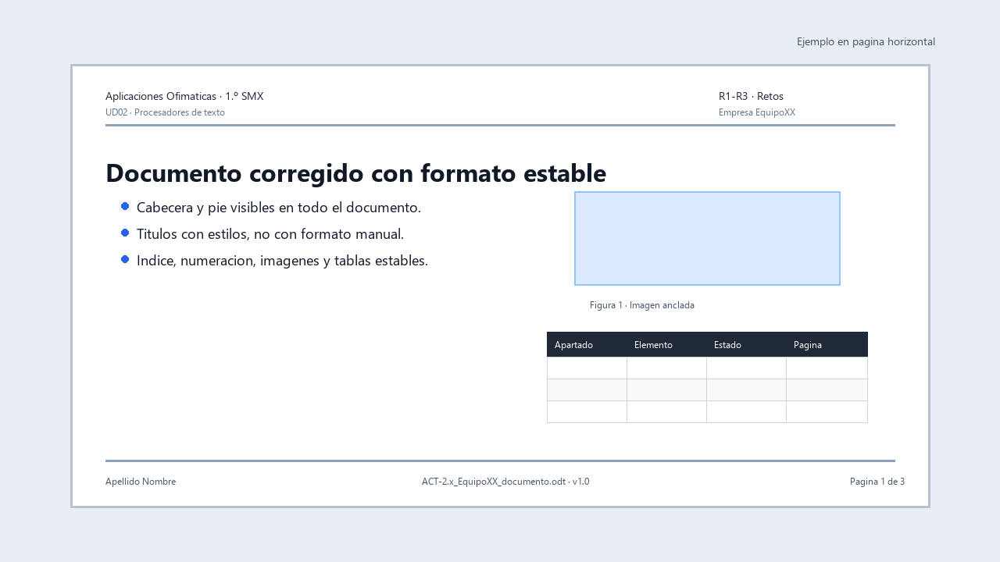

# R1-R3 · Retos de formato

*Ejemplo visual orientativo: no hay que copiarlo exactamente, pero muestra el tipo de mejora que se busca en cada reto.*

**Tarea en Aules:** `R1-R3 · Retos de formato`
**Archivo:** `R1-R3_apellido_nombre_formato.zip` · **Individual** · 3 h.

## Encargo

Antes de crear documentos nuevos para la empresa, debes demostrar que sabes reparar documentos mal construidos. Recibirás tres archivos con errores habituales: espacios para alinear, títulos falsos, listas manuales, imágenes inestables, saltos de página incorrectos e índices que no funcionan.

## Reto 1 · Limpiar formato básico

Corrige un documento corto con problemas de carácter y párrafo:

1. Activa caracteres no imprimibles.
2. Elimina espacios dobles, tabulaciones innecesarias y líneas vacías.
3. Sustituye títulos manuales por estilos.
4. Ajusta sangrías, alineación e interlineado.
5. Inserta salto de página correcto si procede.
6. Exporta a PDF y comprueba el resultado.

## Reto 2 · Ordenar listas, tablas e imágenes

Corrige un documento con elementos mixtos:

1. Convierte listas falsas en listas automáticas.
2. Ajusta una tabla para que se lea completa.
3. Inserta o corrige una imagen con anclaje adecuado.
4. Añade pie de imagen.
5. Revisa que nada se mueva al añadir un párrafo antes.

## Reto 3 · Preparar estructura para índice

Corrige un documento más largo:

1. Aplica `Título 1` y `Título 2`.
2. Inserta índice automático.
3. Actualiza numeración.
4. Crea encabezado y pie con número de página.
5. Exporta PDF con índice revisado.

## Entrega

Un ZIP individual con:

- Los tres documentos editables corregidos.
- Los tres PDF exportados.
- Una nota breve indicando tres errores detectados y cómo los has solucionado.

## Evaluación

**CA:** RA2.b, RA2.c y RA2.d.

Se valorará especialmente que el documento quede construido de forma estable, no solo aparentemente bonito. Si al añadir texto se rompe la maquetación, el reto no está resuelto.

## Cómo reparar sin borrar el contenido

Guarda una copia de cada documento defectuoso antes de tocarlo. Activa los caracteres no imprimibles. En una nota escribe problema, corrección y prueba realizada. Consulta [Formato de carácter y párrafo](ud02-teoria-0.md) si no distingues espacio, tabulador y salto.

### R1. Limpieza guiada

1. Localiza una línea centrada con espacios. Borra esos espacios y aplica alineación centrada al párrafo.
2. Localiza líneas vacías para separar texto. Sustitúyelas por espaciado de párrafo.
3. Convierte los guiones escritos en una lista automática.
4. Busca espacios dobles y revisa cada sustitución. No elimines contenido para «limpiar».
5. Inserta una frase en mitad del documento y verifica que la alineación y las listas siguen funcionando.

### R2. Reconstrucción guiada

1. Identifica apartados principales y secundarios por su contenido.
2. Aplica Título 1 y Título 2. Elimina formato directo que impida ver el estilo.
3. Comprueba la jerarquía en el Navegador.
4. Sustituye el índice manual por uno automático.
5. Modifica Título 1 y comprueba que cambian todos los principales; añade un apartado y actualiza el índice.

### R3. Estabilidad guiada

1. Comprueba anclaje y ajuste de cada imagen; prueba como carácter cuando sea una captura entre párrafos.
2. Revisa ancho de tabla y repetición de cabecera.
3. Sustituye números escritos en el pie por campos.
4. Revisa saltos y páginas en blanco. Actualiza índice y referencias.
5. Añade texto antes de una imagen y verifica que no tapa contenido. Retíralo después.
6. Exporta y abre el PDF. Debe corresponder al editable corregido.

**Entrega:** comprime los tres editables, sus PDF y una nota breve con un fallo corregido y una prueba por reto. Se trata de aprender a diagnosticar: conservar el aspecto sin corregir la estructura no resuelve el reto.
