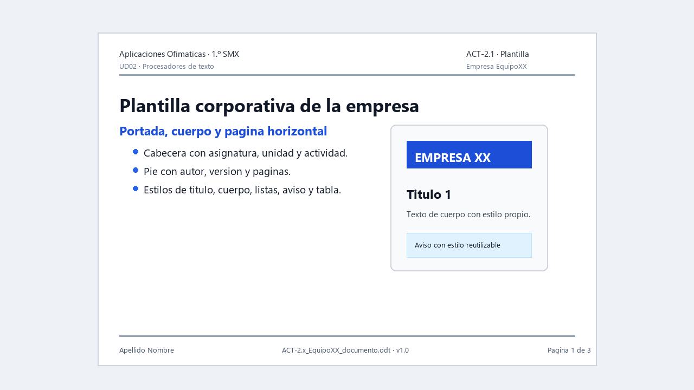

# ACT-2.1 · La identidad documental de la empresa

*Ejemplo visual orientativo: no hay que copiarlo exactamente, pero muestra una plantilla con portada, estilos y páginas diferenciadas.*

**Tarea en Aules:** `ACT-2.1 · La identidad documental de la empresa`
**Archivo:** `ACT-2.1_EquipoXX_plantilla.zip` · **Pareja** · 4 h.

## Encargo

La empresa ya tiene nombre y actividad, pero sus documentos todavía parecen hechos por personas distintas. La pareja debe crear una **plantilla corporativa única** que sirva para informes, presupuestos, manuales y comunicaciones.

La plantilla no es un documento decorado. Debe ser un sistema reutilizable: estilos, portada, cabecera, pie, listas, colores, versiones y prueba real.

## Antes de empezar

1. Abre la carpeta `EMPRESA_EquipoXX`.
2. Crea dentro una subcarpeta `02_sistema_documental`.
3. Registra en el documento de empresa quién edita la plantilla, quién revisa y qué decisiones se toman.
4. Acordad colores, tipografía, tono y datos que aparecerán en cabecera o pie.

## Parte 1 · Diseñar el sistema de estilos

Definid y documentad:

1. Colores corporativos.
2. Estilo `Título 1`.
3. Estilo `Título 2`.
4. Estilo de cuerpo de texto.
5. Estilo de aviso o destacado.
6. Estilo de carácter para términos técnicos.
7. Lista numerada para procedimientos.
8. Lista con viñetas para requisitos.
9. Página de portada.
10. Página interior con cabecera y pie.

!!! warning "No reinventes los títulos"
    Los títulos principales deben conservar nivel de esquema para que el índice de ACT-2.2 y ACT-2.5 funcione. Modifica estilos existentes cuando sea posible.

## Parte 2 · Construir la plantilla

La plantilla debe incluir:

- Portada con nombre de empresa, título del documento, versión y fecha.
- Tabla de control de versiones.
- Encabezado con identidad de empresa.
- Pie con número de página automático.
- Estilos definidos y nombrados con claridad.
- Una página de ejemplo con títulos, texto, lista, tabla e imagen.

Guarda la plantilla en formato `OTT`. Si trabajas con Word, conserva también la versión `DOTX`, pero la entrega principal debe dejar claro cuál se usará en la empresa.

## Parte 3 · Probar la plantilla

1. Abre la plantilla como documento nuevo.
2. Comprueba que no estás escribiendo encima de la plantilla original.
3. Crea un documento de prueba de dos páginas.
4. Inserta títulos, lista, tabla e imagen.
5. Exporta a PDF.
6. Corrige en la plantilla original cualquier error detectado.

## Entrega

Un ZIP de pareja con:

- Plantilla final `.ott`.
- Documento de prueba editable.
- PDF del documento de prueba.
- Nota de decisiones: colores, estilos, cabecera, pie, responsables y versión.
- Captura o evidencia del registro de versiones en `EMPRESA_EquipoXX`.

## Evaluación

**CA:** RA2.a, RA2.b y RA2.c.

Se evaluará que la plantilla sea reutilizable, coherente con la empresa, técnicamente estable y comprendida por los dos miembros de la pareja.

## Guion de trabajo: una fase cada vez

Lee primero [Estilos y plantillas](../Teoria/02_estilos_y_plantillas.md). En cada fase guardad un resultado antes de pasar a la siguiente. Alternad las funciones de edición y revisión: los dos debéis realizar alguna parte y poder explicar el conjunto.

### Fase 1. Decidir antes de maquetar

Completad una ficha con: empresa, lector habitual, fuente disponible en ambos equipos, color principal, color de aviso y datos del pie. Escribid una razón por decisión. Ejemplo: «Usamos azul oscuro en títulos porque mantiene contraste sobre blanco». Evitad «porque queda bonito» como única explicación.

### Fase 2. Construir con contenido de prueba

1. Cread un documento vacío. Escribid marcadores `[TÍTULO]`, `[AUTOR]`, `[FECHA]` y `[VERSIÓN]` en la portada.
2. Aplicad y modificad los estilos de título y cuerpo desde el panel de estilos. Cread `Aviso` y un estilo de carácter para nombres de archivo.
3. Insertad un salto para entrar en la página interior. Activad allí cabecera y pie; insertad el número como campo.
4. Añadid «Objetivo» y «Procedimiento» como títulos principales, y «Comprobación» como subapartado.
5. Insertad una lista de pasos, una de requisitos y una tabla de dos columnas: `Versión` y `Cambio`.
6. Insertad una imagen de ensayo sin datos personales, con proporción conservada y anclaje comprobado.
7. Guardad como plantilla OTT. En el documento de empresa anotad nombre del archivo y versión.

### Fase 3. Probar como si fuerais otra persona

El integrante que no estaba editando crea un documento nuevo desde la plantilla. Completa los marcadores, añade dos páginas de prueba y cambia el estilo `Título 1`. Todos los títulos de ese nivel deben cambiar. Exporta a PDF y comprueba cabecera, pie y objetos. Si aparece un fallo, corregid la plantilla y generad otra prueba.

### Nota de decisiones lista para completar

| Decisión | Valor elegido | Motivo | Quién propone | Quién comprueba |
| --- | --- | --- | --- | --- |
| Cuerpo | [Fuente y tamaño] | [Legibilidad y disponibilidad] | [Nombre] | [Nombre] |
| Títulos | [Niveles y formato] | [Jerarquía] | [Nombre] | [Nombre] |
| Pie | [Datos y campo] | [Identificación] | [Nombre] | [Nombre] |

### Revisión del ZIP

Incluid `plantilla.ott`, `prueba.odt`, `prueba.pdf` y `decisiones` en un formato legible. Abrid el ZIP y comprobad los archivos desde una carpeta de prueba. No entreguéis solo una captura: debe ser posible crear un documento con la plantilla.

**Para explicar vuestro trabajo:** mostrad un estilo, el campo de página y el procedimiento para crear un documento nuevo. Si el índice futuro no reconoce un título, revisad su estilo y nivel de esquema, no su tamaño.
