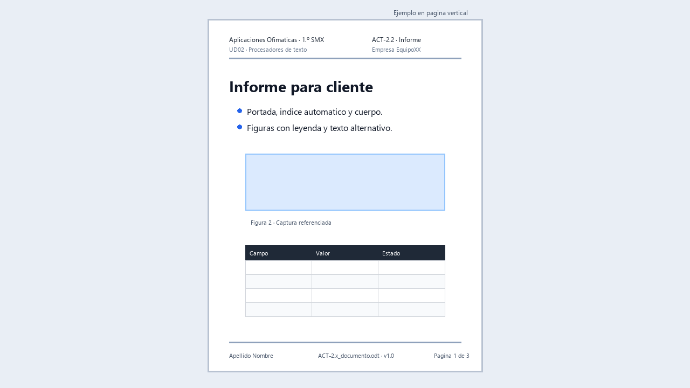

# ACT-2.2 · El informe, versión cliente



*Ejemplo visual orientativo: no hay que copiarlo exactamente, pero muestra la estructura esperada de portada, índice, cuerpo, figuras y tablas.*

**Tarea en Aules:** `ACT-2.2 · El informe, versión cliente`
**Archivo:** `ACT-2.2_apellido_nombre_informe.zip` · **Individual** · 5 h.

## Encargo

Elige una evidencia propia de UD01 y conviértela en un informe profesional para un cliente. No se trata de copiar y pegar el trabajo anterior: hay que reescribirlo, estructurarlo y presentarlo con la plantilla de empresa.

El informe debe poder entregarse a una persona que no ha visto tus prácticas de clase.

## Punto de partida

Puedes partir de:

- ACT-1.1 instalación documentada.
- ACT-1.2 auditoría de licencias.
- ACT-1.3 compatibilidad entre suites.
- ACT-1.4 diagnóstico de incidencia.
- ACT-1.5 auditoría de hardware.

Elige una sola evidencia y conviértela en un documento de cliente.

## Trabajo

1. Crea un documento nuevo desde la plantilla de ACT-2.1.
2. Redacta una portada clara.
3. Añade índice automático.
4. Organiza el contenido con títulos numerados.
5. Incluye una tabla de datos o comparación.
6. Inserta capturas útiles con pie de imagen.
7. Añade al menos una nota al pie o aclaración técnica.
8. Añade dos referencias cruzadas.
9. Incluye una conclusión comprensible para el cliente.
10. Exporta PDF con marcadores o enlaces cuando sea posible.

## Revisión obligatoria

Antes de entregar:

1. Actualiza índice y campos.
2. Comprueba que las imágenes no se mueven.
3. Revisa ortografía.
4. Abre el PDF y prueba el índice.
5. Comprueba nombre de archivo y metadatos básicos.

## Entrega

Un ZIP individual con:

- Informe editable.
- Informe en PDF.
- Nota breve comparando la versión original de UD01 con la versión cliente.
- Indicación de qué plantilla se ha utilizado.

## Evaluación

**CA:** RA2.b, RA2.c y RA2.d.

Se valorará la transformación profesional del contenido: claridad, estructura, uso real de estilos, referencias, tablas, capturas y PDF final revisado.

## Recorrido guiado para transformar tu informe

Consulta [Documento complejo](../Teoria/03_imagenes_y_objetos.md) e [Índices y PDF](../Teoria/04_documentos_largos.md). Mantén tu evidencia original de UD01 como referencia; el nuevo informe debe basarse en pruebas que realmente realizaste.

### Fase 1. Elegir y ordenar la información

Escribe en una hoja: quién es el cliente ficticio, qué problema tenía, qué hiciste, qué prueba demuestra el resultado y qué debe hacer ahora el cliente. Si no tienes una evidencia para una afirmación, no inventes una captura ni un resultado.

Usa este esquema como punto de partida:

```text
Portada y versión
Índice automático
1. Objetivo y situación inicial
2. Trabajo realizado
   2.1. Preparación
   2.2. Intervención
3. Resultados y comprobaciones
4. Recomendaciones para el cliente
Fuentes y comparación con la versión de UD01
```

### Fase 2. Redactar para alguien que no estuvo en clase

Una frase como «instalé y ya funciona» no explica el trabajo. Ejemplo mejorado, que solo usarás si corresponde a tu prueba: «Se instaló la suite en el equipo de ensayo. Después se creó, guardó y abrió de nuevo un documento para comprobar su funcionamiento». Explica siglas la primera vez y evita afirmar que un sistema es perfecto por superar una única prueba.

1. Crea el documento desde la plantilla y pega el contenido sin formato.
2. Aplica títulos de niveles 1 y 2. Configura numeración automática.
3. Crea una tabla con columnas como `Elemento`, `Estado inicial`, `Acción` y `Comprobación`.
4. Elige capturas que acrediten acciones distintas. Recorta, inserta, añade leyenda y texto alternativo. Escribe qué demuestra cada una.
5. Inserta una nota al pie para una aclaración o fuente. No uses la nota para esconder una explicación imprescindible.
6. Inserta dos referencias cruzadas, por ejemplo a un apartado y a una figura, mediante campos.
7. Genera el índice y redacta una conclusión con resultado, límite de la prueba y recomendación.

### Fase 3. Revisar estructura y exportación

Añade temporalmente un párrafo antes de una captura y una página antes de los resultados. Actualiza índices y campos. Comprueba que referencias y paginación cambian correctamente. Retira lo añadido, actualiza, guarda y exporta de nuevo. En el PDF prueba índice, marcadores y enlaces.

### Comparación final lista para completar

| En UD01 | En la versión cliente | Qué mejora para el lector |
| --- | --- | --- |
| [Título/formato anterior] | [Estilo aplicado] | [Navegación o coherencia] |
| [Captura sin explicación] | [Leyenda y texto] | [Qué prueba permite entender] |
| [Conclusión anterior] | [Recomendación concreta] | [Qué puede hacer el cliente] |

**Entrega comprobable:** editable, PDF, comparación y plantilla utilizada identificada por nombre y versión. No añadas requisitos inventados para rellenar páginas; la calidad se demuestra con contenido útil y elementos automáticos que funcionan.
