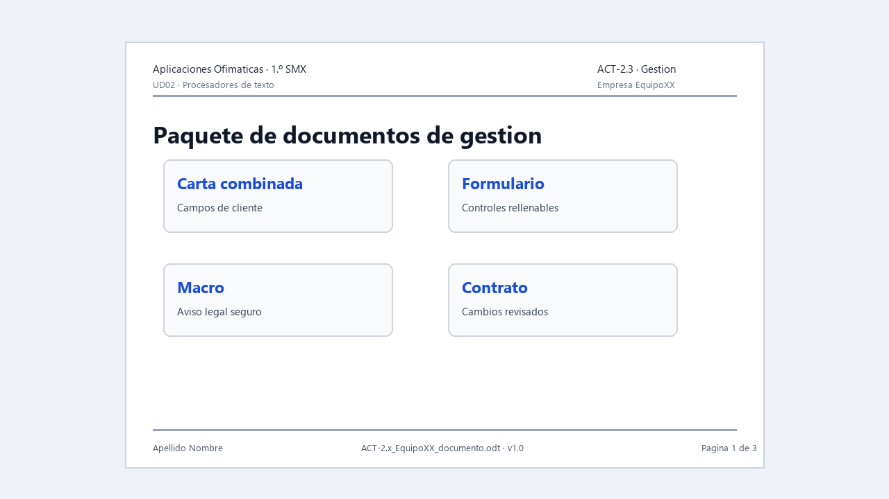

# ACT-2.3 · Documentos de gestión



*Ejemplo visual orientativo: no hay que copiarlo exactamente, pero muestra las cuatro piezas que deben funcionar como documentos reales.*

**Tarea en Aules:** `ACT-2.3 · Documentos de gestión`
**Archivo:** `ACT-2.3_apellido_nombre_gestion.zip` · **Individual** · 4 h.

## Encargo

La empresa necesita documentos repetitivos y revisables: cartas para clientes, formularios de solicitud, pequeños automatismos y contratos con cambios controlados.

Vas a crear un paquete de documentos de gestión utilizando datos ficticios y cuidando compatibilidad, protección de datos y revisión.

## Parte 1 · Carta combinada

1. Crea una tabla con cinco clientes ficticios.
2. Diseña una carta base con la identidad de empresa.
3. Inserta campos de combinación.
4. Genera una vista previa de varios destinatarios.
5. Exporta una muestra a PDF.

## Parte 2 · Formulario

1. Crea un formulario de solicitud de soporte o alta de cliente.
2. Incluye campos de texto, lista o casillas.
3. Protege o prepara el documento para ser rellenado.
4. Exporta a PDF si el formulario lo permite.
5. Prueba que se puede completar.

## Parte 3 · Macro documentada

Graba o prepara una macro sencilla y segura. Por ejemplo:

- Aplicar formato de aviso.
- Insertar un bloque de datos de empresa.
- Limpiar dobles espacios.
- Crear una tabla de seguimiento.

La macro debe probarse en una copia y explicarse con lenguaje claro.

## Parte 4 · Contrato revisado

1. Abre un contrato breve o documento de condiciones.
2. Activa control de cambios.
3. Realiza varias correcciones justificadas.
4. Añade dos comentarios.
5. Genera una versión revisada y una versión limpia.
6. Comprueba compatibilidad `DOCX` si se solicita.

## Entrega

Un ZIP individual con:

- Carta base y muestra PDF.
- Fuente de datos ficticia.
- Formulario editable y PDF si procede.
- Documento con macro y nota explicativa.
- Contrato con cambios y contrato limpio.
- Nota de compatibilidad y protección de datos.

## Evaluación

**CA:** RA2.a, RA2.d, RA2.e y RA2.f.

Se valorará que los documentos sean útiles para una empresa real, que los datos sean ficticios, que la revisión sea trazable y que no se habiliten macros desconocidas.

## Guion completo y materiales de partida

Lee [Documentos de gestión](../Teoria/05_documentos_gestion.md), donde se explican registro, campo, control de formulario y macro. Prepara cuatro subcarpetas: `01_carta`, `02_formulario`, `03_macro` y `04_revision`.

### 1. Carta: de cinco filas a cinco comunicaciones

Crea una hoja con encabezados `Nombre`, `Empresa`, `Poblacion`, `Servicio` y `Equipo`. Usa los tres registros de ejemplo de la teoría y añade dos inventados. Comprueba que cada fila describe un cliente y que no hay filas vacías entre registros.

Texto base que debes adaptar: «Hola, [Nombre]. Te informamos de que nuestra empresa ha preparado el servicio [Servicio] para el equipo [Equipo] de [Empresa]. Para solicitar asistencia, utiliza el formulario de soporte».

1. Crea la carta desde la plantilla.
2. Conecta la hoja mediante el asistente de combinación.
3. Sustituye cada marcador por un campo real de la fuente, no por texto escrito manualmente.
4. Recorre los cinco registros y revisa que nombre, servicio y equipo correspondan a la misma fila.
5. Genera el resultado combinado y una muestra PDF. Conserva carta base y hoja para poder repetirlo.

**Comprobación:** cambia el servicio de un cliente en la hoja y vuelve a generar. Solo su carta debe reflejar ese cambio. Si todas muestran el mismo nombre, revisa que hayas generado registros distintos y no repetido una copia de la vista previa.

### 2. Formulario: construir y rellenar

Incluye etiquetas claras para equipo, descripción, fecha, tipo de incidencia, prioridad y confirmación de revisión. Usa texto para la descripción, lista para tipo y casilla para confirmación. Si incorporas prioridad mediante botones de opción, agrúpalos para permitir una sola elección.

Activa controles de formulario y modo diseño. Crea los controles, asigna nombres como `equipo` y `descripcion`, configura opciones y alinea. Desactiva diseño y rellena una solicitud de prueba. Exporta como PDF rellenable cuando corresponda y vuelve a abrir una copia guardada con respuestas.

**Resultado esperado:** otra persona puede rellenar sin preguntarte dónde escribir. Una línea dibujada no cuenta como campo interactivo. Anota visor usado, si permitió rellenar y si conservó los datos.

### 3. Macro: una tarea pequeña que puedas demostrar

Usa el ensayo de inserción de aviso explicado en la teoría. Graba en una copia, guarda la macro en el documento de prueba y ejecútala en un párrafo vacío. No habilites macros ajenas para completar la actividad.

Completa esta ficha:

```text
Nombre de la macro:
Tarea que automatiza:
Dónde está guardada:
Cómo se ejecuta:
Qué debe ocurrir:
Qué ocurrió en mi prueba:
Limitación detectada:
Cómo volver atrás si el resultado no es el esperado:
```

Si el grabador de tu instalación no está disponible o no registra una acción, deja constancia del problema y resuélvelo con el docente antes de dar la parte por terminada.

### 4. Revisión: dos versiones con funciones distintas

Usa el documento de condiciones facilitado por el docente. Para ensayar previamente puedes usar el texto ficticio de la teoría, identificado como ejercicio.

1. Conserva el original y crea una copia para revisión.
2. Activa control de cambios. Haz una corrección de redacción y una propuesta de contenido; explica su motivo.
3. Añade dos comentarios concretos: qué revisar y por qué.
4. Guarda la versión con cambios visibles.
5. Crea otra copia. Acepta o rechaza cada propuesta con criterio y resuelve comentarios.
6. Guarda la versión limpia. Si se prueba DOCX, registra suite y problemas observados; corrige y vuelve a abrir.

### Registro de pruebas para el ZIP

| Pieza | Prueba | Resultado | Corrección |
| --- | --- | --- | --- |
| Carta | Primer y último registro | [Qué aparece] | [Si hubo fallo] |
| Formulario | Rellenar, guardar y reabrir | [Visor y resultado] | [Si hubo fallo] |
| Macro | Ejecutar en copia | [Acción real] | [Límite o cambio] |
| Revisión | Abrir versión limpia | [Cambios pendientes sí/no] | [Cómo se resolvieron] |

Incluye las fuentes y resultados de las cuatro piezas. El registro de pruebas permite explicar qué funciona; no marques «correcto» sin realizar la prueba.
