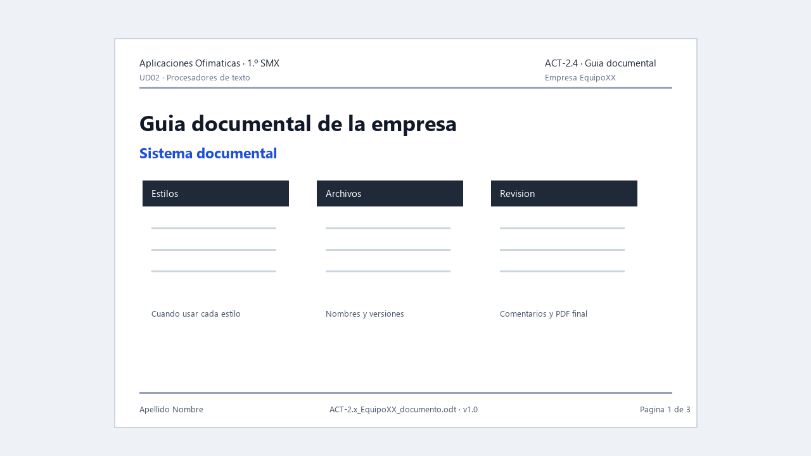

# ACT-2.4 · La web documental de la empresa



*Ejemplo visual orientativo: no hay que copiarlo exactamente, pero muestra una guía con normas claras sobre estilos, archivos y revisión.*

**Tarea en Aules:** `ACT-2.4 · La web documental de la empresa`
**Archivos:** `ACT-2.4_EquipoXX_web.pdf` y `ACT-2.4_EquipoXX_web.md` · **Pareja** · 3 h.

## Encargo

La empresa necesita una página sencilla donde organizar su documentación: quiénes somos, qué plantilla usamos, qué formatos se aceptan, cómo se entregan documentos y qué normas deben seguir los integrantes.

No es una web publicitaria. Es una web o página documental para trabajar mejor.

## Qué debe contener

La página debe incluir:

1. Nombre de la empresa y actividad.
2. Cliente objetivo.
3. Servicios principales.
4. Enlace o referencia a la plantilla corporativa.
5. Tabla de formatos internos y formatos de entrega.
6. Normas de estilo documental.
7. Protocolo breve de revisión.
8. Protocolo básico de protección de datos.
9. Enlaces o referencias a documentos creados en UD02.
10. Registro de versión de la web.

## Requisitos técnicos

Se realiza en **Markdown dentro de Visual Studio Code**, con vista previa y exportación mediante **Markdown PDF**, de yzane. No se exige publicar una web ni instalar Python o MkDocs.

Debe cumplir:

- Títulos jerárquicos.
- Navegación clara.
- Enlaces comprobados.
- Imágenes o capturas sin datos personales.
- Texto propio y adaptado a la empresa.
- Coherencia con la plantilla de ACT-2.1.

## Trabajo en pareja

1. Repartid secciones.
2. Revisad que todo use el mismo tono.
3. Comprobad enlaces y permisos.
4. Registrad contribuciones en `EMPRESA_EquipoXX`.
5. Exportad la guía completa a PDF desde VS Code y revisad todas sus páginas.

## Entrega

Un PDF y el archivo Markdown editable por pareja: la guía documental con el nombre de la empresa, los integrantes y la fecha, y una captura final del trabajo en Visual Studio Code. Más abajo se explica cómo hacerla.

## Evaluación

**CA:** RA2.b, RA2.d y RA2.f.

Se valorará que la web organice la documentación real de la empresa, no que tenga efectos visuales. Debe servir para que un compañero entienda cómo crear, revisar y entregar documentos de la empresa.

## Paso a paso para tu primera web documental

Antes de empezar, realiza el ensayo de [Markdown desde cero](../Teoria/06_markdown_ia_web.md) y sigue [la instalación de Markdown PDF y la exportación desde VS Code](../Teoria/07_exportar_pdf_vscode.md). Usaremos un único archivo `ACT-2.4_EquipoXX_web.md` con todos los apartados para generar un PDF completo.

### Fase 1. Preparar los materiales reales

Reúne el nombre y actividad de tu empresa, las decisiones de ACT-2.1 y los documentos terminados. Usa datos ficticios. Copia la plantilla y un PDF aprobado a `archivos` del proyecto de ensayo. No enlaces una carpeta privada de tu ordenador.

Reparte trabajo: una persona prepara los apartados de presentación y documentos; otra prepara las normas. Después intercambiad páginas para revisar. Ambos deben abrir y comprobar los enlaces. Reunid las aportaciones en un único Markdown antes de exportar.

### Fase 2. Completar una estructura casi preparada

Utiliza esta base para `ACT-2.4_EquipoXX_web.md`. Sustituye todos los corchetes que contienen datos pendientes; conserva los corchetes de los enlaces Markdown.

```md
# [NOMBRE DE EMPRESA] · Guía documental

## Para qué sirve esta guía

Somos una empresa ficticia de [ACTIVIDAD]. Ayudamos a [CLIENTE OBJETIVO].
Esta guía explica cómo crear, revisar y entregar nuestros documentos.

## Servicios

- [SERVICIO REAL DEFINIDO EN EL PROYECTO]
- [OTRO SERVICIO]

## Empieza aquí

1. Lee el apartado Normas de estilo de esta guía.
2. Consulta el apartado Documentos y plantillas.
3. Crea el documento y sigue el protocolo de revisión.

## Versión de la guía

| Versión | Fecha | Cambio | Responsable |
| --- | --- | --- | --- |
| 1.0 | [FECHA] | Primera guía documental | [INTEGRANTES] |
```

En el mismo archivo, añade `## Normas de estilo` y crea los subapartados de tercer nivel (`###`) `Estilos`, `Imágenes y tablas`, `Nombres de archivo`, `Revisión` y `Protección de datos`. Cada norma debe indicar una acción concreta y cómo comprobarla.

Ejemplo resuelto: «Aplica Título 1 a los apartados principales. Comprueba que aparecen en el Navegador antes de generar el índice». Una norma como «hacerlo profesional» no indica una acción verificable.

Incluye un ejemplo correcto y uno incorrecto con explicación: «Separar párrafos mediante espacio después» frente a «Pulsar Enter repetidamente». Añade un protocolo numerado: revisar contenido, actualizar campos, revisar capturas, guardar editable, exportar PDF y comprobarlo en un visor.

Después, en el mismo archivo, añade:

```md
## Documentos y plantillas

### Formatos que usamos

| Documento | Formato de trabajo | Formato de entrega |
| --- | --- | --- |
| Informe | ODT | PDF revisado |
| Plantilla | OTT | OTT y documento de prueba |

### Archivos disponibles

- [Descargar plantilla corporativa](archivos/plantilla.ott)
- [Consultar informe de ejemplo](archivos/informe.pdf)
```

La tabla es un ejemplo: adaptadla a las decisiones aprobadas. Los archivos enlazados deben existir con esos nombres o debéis corregir las rutas. Si un manual todavía no está terminado, señaladlo como pendiente, sin crear un enlace roto ni afirmar que ya existe.

### Fase 3. Usar IA con revisión, si lo elegís

Podéis usar el prompt de la teoría para un borrador. Cambiad los datos a vuestra empresa. Corregid hechos, rutas y estructura e indicad al final de la guía qué IA habéis usado y para qué. Si no usáis IA, indicadlo. La IA no puede comprobar por vosotros que se descarga vuestra plantilla.

### Fase 4. Visualizar, probar y exportar

1. Guarda el Markdown y abre **Markdown: Abrir vista previa al lado** desde **Ctrl+Mayús+P**.
2. Pide a tu compañero que encuentre los formatos, las normas, la plantilla y el protocolo de revisión.
3. Comprueba los enlaces a los archivos desde la vista previa. Corrige los que fallen.
4. Añade el nombre de la empresa, los integrantes y la fecha al principio del Markdown. Al final, indica brevemente qué ha hecho cada integrante y si habéis usado IA y para qué. Añade también la captura que se explica en la entrega.
5. Selecciona la pestaña del Markdown y guarda. Pulsa **Ctrl+Mayús+P → Markdown PDF: Export (pdf)**.
6. Abre el PDF generado y revisa todas las páginas. Si hay tablas o imágenes cortadas, corrige el Markdown y vuelve a exportar.
7. Comprueba que se llama `ACT-2.4_EquipoXX_web.pdf`, sustituyendo XX por vuestro equipo.

### Entrega en Aules

Subid **dos archivos**, sin ZIP (sustituid XX por vuestro equipo):

- `ACT-2.4_EquipoXX_web.pdf`: la guía y la captura de VS Code.
- `ACT-2.4_EquipoXX_web.md`: el archivo Markdown editable con el que habéis creado la guía.

Para guardar el Markdown, pulsad **Ctrl+S** en VS Code. Si todavía no tiene nombre, usad **Archivo → Guardar como…** y escribid `ACT-2.4_EquipoXX_web.md`. Es el archivo de texto que editáis, no la vista previa.

El PDF debe incluir:

1. **La guía documental**, con los apartados del encargo, el nombre de la empresa, los integrantes y la fecha.
2. **Una captura de vuestro trabajo en Visual Studio Code**, al final de la guía. Deben verse el nombre del archivo `.md`, el código Markdown a la izquierda y su vista previa a la derecha. Elegid un fragmento propio con un título y una tabla o un enlace, y comprobad que se lee bien.
3. **Dos o tres líneas finales**: qué ha hecho cada integrante y si habéis usado IA y para qué.

**Cómo añadir la captura:**

1. Abrid vuestro `.md` en VS Code y la vista previa al lado con **Ctrl+Mayús+P → Markdown: Abrir vista previa al lado**.
2. Capturad la ventana con **Win+Mayús+S** y guardad la imagen como `evidencia_vscode.png` dentro de la carpeta `imagenes` del proyecto. Evitad mostrar datos personales ajenos a la actividad.
3. Añadid al final del Markdown:

```md
## Evidencia del trabajo


```

4. Guardad y exportad de nuevo con **Markdown PDF: Export (pdf)**. Abrid el PDF y comprobad que incluye la guía y la captura legible.

**No hay que entregar un ZIP.** Conservad también las carpetas del proyecto en `EMPRESA_EquipoXX` para poder enseñarlas en clase. Las imágenes se verán en el PDF; el `.md` permite revisar el código aunque no se adjunten esas carpetas. Comprobad los enlaces locales desde la vista previa; pueden dejar de abrirse al mover el PDF a otro ordenador.

**Comprobación en clase:** cada integrante debe poder abrir el Markdown, explicar una marca que haya utilizado y volver a exportar el PDF desde VS Code.
