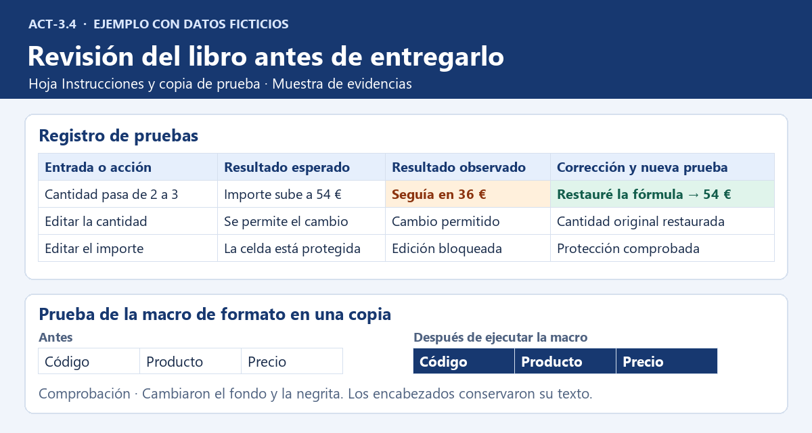

# ACT-3.4 · Lo probamos antes de entregarlo

**Duración: 6 horas, incluyendo explicación y práctica. RA3. Evidencia individual y posterior integración por parejas.**

## Encargo

Una persona distinta debe poder utilizar tu libro. Primero revisas tu trabajo individual y después integras con tu pareja la versión de empresa.

## Antes de empezar

Consulta los datos comunes y la teoría correspondiente. No necesitas inventar una empresa nueva ni pagar ninguna herramienta. Se admite Calc o Excel en el entorno acordado por el profesor.

### Cómo aprender el procedimiento

[Revisión y protección con un fallo simulado](../Teoria/T05_revision.md). El taller de macro de esta actividad desarrolla preparación, grabación, ejecución y reapertura.

## Ejemplo visual

Fíjate en cómo se registra el fallo y qué ocurrió al repetir la prueba tras corregirlo. En la copia de prueba, la macro cambia el aspecto de la cabecera. Usa tus propias pruebas y separa la evidencia individual de la entrega de PROY-3.

## Trabajo paso a paso

1. Guarda una copia y ejecuta las pruebas comunes de la rúbrica.
2. Corrige al menos un fallo detectado; si no encuentras ninguno, el docente introducirá uno en una copia.
3. Distingue entradas y fórmulas, protege una hoja y comprueba ambos tipos de celdas.
4. Graba la macro mínima de formato en una copia, con ayuda y en el entorno que indique el profesor. Conserva el formato que permite ejecutarla.
5. Introduce un código mediante teclado y añade una imagen propia de producto, indicando cómo se capturó. Prueba el lector si está disponible.
6. Completa Instrucciones: aplicación, entradas, actualización, impresión y limitaciones.
7. Realiza el control individual de 40 minutos.
8. Compara con tu pareja las soluciones de las tres actividades y elegid una base justificada.
9. Integrad PROY-3 y actualizad decisiones, versiones y contribuciones.
10. Cada integrante explica una fórmula y realiza un cambio distinto en directo.

## Taller guiado · Grabar y probar FormatoCabecera

Reserva unos 30–40 minutos del primer tramo de 2 h para la demostración y repetición individual. No añade horas a ACT-3.4. Sigue solo la ruta de la aplicación acordada con el profesor.

### A. Prepara una copia que puedas recuperar

1. Abre tu libro individual y guarda primero los cambios de revisión.
2. Usa Guardar como para crear `ACT-3.4_Apellido_Nombre_Macro.ods` en Calc o `ACT-3.4_Apellido_Nombre_Macro.xlsm` en Excel de escritorio. Comprueba el tipo de archivo, no solo el texto del nombre.
3. Añade una hoja llamada `PruebaMacro`, sin protección. Introduce A1 = Código, B1 = Producto y C1 = Stock. Repite los títulos en A4:C4. Déjalos sin negrita y con fondo sin relleno.
4. Anota la acción prevista: «Aplicar negrita y fondo azul claro a una cabecera, sin cambiar sus textos ni los datos del libro». Guarda la copia.

### B. Ruta principal · LibreOffice Calc en Windows

1. Si falta la grabadora, el profesor comprobará **Herramientas → Opciones → LibreOffice → Avanzadas → Activar grabación de macros (limitada)**. Acepta y reinicia solo si la aplicación lo solicita. Activar la grabadora no equivale a permitir todas las macros.
2. En PruebaMacro selecciona A1:C1 **antes** de grabar. Puedes escribir `A1:C1` en el cuadro de nombre, a la izquierda de la barra de fórmulas, y pulsar Enter.
3. Abre **Herramientas → Macros → Grabar macro**. Debe aparecer el control **Finalizar grabación**.
4. Aplica negrita con el botón de formato y elige un fondo azul claro legible. No escribas títulos nuevos, no cambies de hoja y no añadas otras acciones durante la grabación.
5. Pulsa **Finalizar grabación**. En el diálogo de guardado elige **el nombre de tu documento abierto**, no Mis macros. Dentro del documento usa la biblioteca Standard y un módulo, por ejemplo Module1; si no existen, créalos mediante los controles de biblioteca/módulo nuevos.
6. Asigna el nombre `FormatoCabecera`, sin espacios, y guarda la macro. Guarda también el documento con Ctrl+S y conserva el formato ODS.
7. Fuera de la grabación, quita la negrita y el fondo de A1:C1. Comprueba que se ven como al inicio. Selecciona ese rango.
8. Usa **Herramientas → Macros → Ejecutar macro**, despliega tu documento y su biblioteca/módulo, elige FormatoCabecera y ejecútala. Deben reaparecer los formatos sin que los apliques manualmente.
9. Selecciona A4:C4 y vuelve a ejecutar. Observa si actúa en la selección o vuelve al rango anterior; registra lo que realmente sucede.

Consulta la [ayuda oficial de grabación](https://help.libreoffice.org/latest/es/text/shared/guide/macro_recording.html) y la [guía de macros de Calc](https://books.libreoffice.org/es/CG262/CG26214-MacrosDeCalc.html). Los nombres y la disposición de los controles pueden variar entre versiones; el docente comprobará la ruta del aula.

### C. Alternativa · Excel de escritorio en Windows

1. Si no ves Programador/Desarrollador, ve a **Archivo → Opciones → Personalizar cinta de opciones** y activa esa pestaña.
2. Selecciona A1:C1 en PruebaMacro antes de empezar. En **Programador → Grabar macro**, escribe `FormatoCabecera`, selecciona **Guardar macro en: Este libro** y deja vacío el atajo de teclado. Acepta.
3. Aplica negrita y fondo azul claro. Pulsa **Programador → Detener grabación** y guarda como **Libro de Excel habilitado para macros (*.xlsm)**. Guardar como XLSX eliminaría la macro de esa copia.
4. Fuera de la grabación, devuelve A1:C1 a sin negrita y sin relleno. Selecciona el rango y entra en **Programador → Macros → FormatoCabecera → Ejecutar**. Comprueba que reaparece el formato.
5. Repite la ejecución con A4:C4 seleccionado. Anota dónde actúa realmente. No necesitas configurar referencias relativas ni editar código para esta práctica.

Consulta [cómo mostrar Programador](https://support.microsoft.com/es-es/office/add-ins/show-the-developer-tab), la [grabadora de Excel](https://support.microsoft.com/es-es/excel/automate-tasks-with-the-macro-recorder) y [cómo conservar el formato del libro](https://support.microsoft.com/es-es/excel/save-your-workbook). Excel en el navegador no ofrece esta grabadora de VBA; utiliza el puesto compatible que indique el profesor.

### D. Comprueba que la macro viaja con tu entrega

1. Guarda y cierra la copia. Abre de nuevo **ese archivo desde su carpeta**, no otro libro con un nombre parecido.
2. Si la ejecución está bloqueada, informa al docente. No cambies la seguridad general a «permitir todas las macros».
3. Comprueba en el selector que FormatoCabecera está dentro del documento. Con la autorización y configuración del aula, repite la prueba sobre la cabecera sin formato. Si es posible, el docente comprobará el archivo en otro perfil o puesto compatible: encontrarla solo en tu ordenador no prueba que viaje con el documento.
4. Guarda el registro en Instrucciones. La macro debe conservar Código, Producto y Stock y no modificar cantidades ni fórmulas de las hojas de gestión.

| Prueba | Qué anotar tú |
| --- | --- |
| Aplicación y archivo | [Aplicación/versión, nombre y extensión] |
| Ubicación de la macro | [Documento, biblioteca/módulo si procede y nombre] |
| Rango original A1:C1 | [Aspecto inicial, ejecución y aspecto observado] |
| Segunda selección A4:C4 | [Qué rango cambió realmente y limitación detectada] |
| Reapertura | [Se encuentra dentro del documento y resultado al repetir, o bloqueo pendiente] |

Incluye una captura propia antes y otra después, acompañadas de este registro; conserva el editable con la macro. Las imágenes son apoyo, no sustituyen su ejecución. Si actúa sobre posiciones fijas o conmuta la negrita al ejecutarla dos veces seguidas, indícalo: restaura la cabecera al estado inicial antes de repetir. No prometas que puede aplicarse sobre cualquier rango.

### E. Si algo no funciona

| Problema | Comprobación siguiente |
| --- | --- |
| No aparece Grabar macro | Comprobar aplicación de escritorio, opciones y permisos con el docente |
| La macro no aparece al reabrir | Revisar que se guardó dentro del documento y en ODS/XLSM; guardarla en el perfil o en XLSX no sirve para esta entrega |
| Cambia otra zona | Revisar las selecciones registradas y documentar el alcance; repetir la grabación breve si incluyó pasos ajenos |
| No se puede aplicar formato | Comprobar que PruebaMacro está sin proteger |
| No se permite ejecutar | Registrar el bloqueo y solicitar la comprobación docente, sin dar la prueba por superada |

Para PROY-3, cread la copia con macro **a partir del libro común final** y repetid esta grabación breve allí. Copiar una pestaña de un libro individual no garantiza copiar la macro. Conservad las evidencias individuales; la pareja registra además la prueba realizada en su archivo común.

## Entrega

`ACT-3.4_Apellido_Nombre`: libro individual revisado y copia `ACT-3.4_Apellido_Nombre_Macro.ods` o `.xlsm`, con el registro de automatización en Instrucciones y capturas antes/después. Si hay un bloqueo de entorno, indica la evidencia pendiente. `PROY-3_EquipoXX` conserva su propia entrega común de libro, PDF, CSV, copia con macro y memoria v3 según el enunciado del proyecto. Son evidencias distintas.

Utiliza ODS en Calc, XLSX en Excel sin macros y XLSM para la copia con macros de Excel. No entregues solo capturas.

## Organización del tiempo

2 h de auditoría y demostración de automatización; 2 h de control individual (40 min) e integración; 2 h de cierre, pruebas y defensas breves. Organizar las defensas durante el trabajo autónomo.

## Ayuda y ampliación

Apoyo: lista de comprobación y macro realizada paso a paso. La ampliación es mejorar las instrucciones; no se pide programar VBA, Basic ni crear botones.

## Antes de entregar

Abre de nuevo el archivo, cambia una entrada y verifica el resultado. El nombre de empresa debe coincidir con UD02. Consulta la rúbrica común; las ampliaciones no sustituyen los requisitos básicos.
